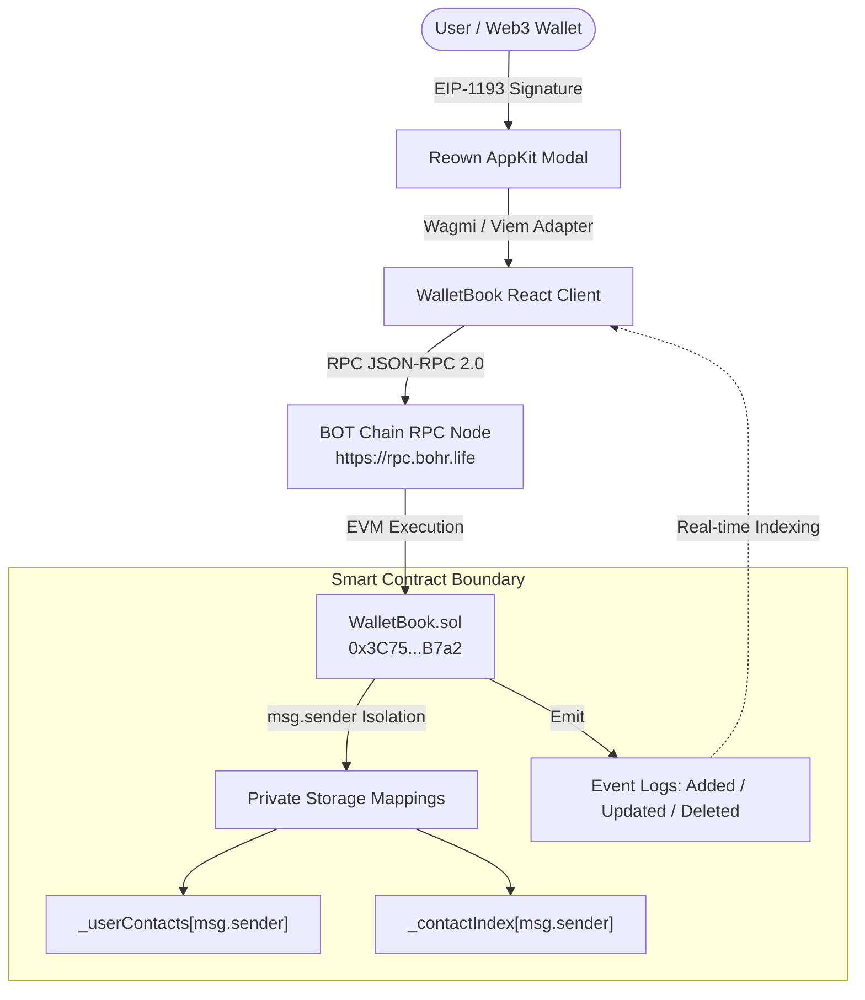
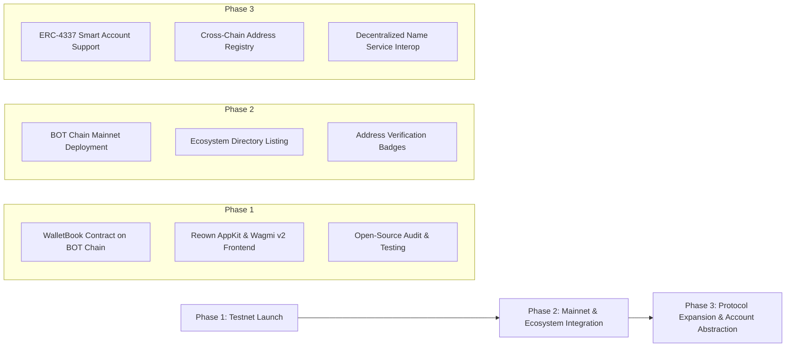

# WalletBook Whitepaper

**A Decentralized, Privacy-Preserving Address Book Protocol on BOT Chain**

**Version:** 1.0.0  
**Date:** November 2026  
**Status:** Live on BOT Chain Testnet  
**Smart Contract:** [`0x3C7558cEfEcA0fECE815D2CfA949bAa7C02bB7a2`](https://scan.bohr.life/address/0x3C7558cEfEcA0fECE815D2CfA949bAa7C02bB7a2)  
**Repository:** [https://github.com/techenthusiast43/Wallet-Book](https://github.com/techenthusiast43/Wallet-Book)  

---

## Abstract

In the decentralized finance (DeFi) and Web3 landscape, user transactions rely fundamentally on 42-character hexadecimal Ethereum Virtual Machine (EVM) addresses. Despite trillions of dollars settled across smart contract networks, the user experience surrounding address management remains error-prone and vulnerable to severe attack vectors—specifically address poisoning, clipboard hijacking malware, and manual transcription errors. 

**WalletBook** introduces a gas-optimized, decentralized address directory deployed natively on the **BOT Chain** network. Built without administrative backdoors or centralized custody, WalletBook enables users to record, label, update, and search verified EVM addresses through a smart contract that guarantees strict caller-scoped access privacy. Operating with $O(1)$ constant-time swap-and-pop storage modifications, WalletBook achieves enterprise-grade gas efficiency while maintaining complete user self-sovereignty.

---

## 1. Introduction

### 1.1 The Web3 Usability & Safety Problem
In standard Web3 workflows, transferring tokens, delegating voting power, or calling multisigs requires users to input hexadecimal addresses formatted under the EIP-55 checksum specification (e.g., `0x3C7558cEfEcA0fECE815D2CfA949bAa7C02bB7a2`). Because hexadecimal strings are unreadable to human cognitive intuition, users routinely rely on copy-pasting addresses from historical transaction logs or centralized chat applications.

### 1.2 Address Poisoning & Social Engineering Attacks
The reliance on visual skimming has given rise to **Address Poisoning Attacks**, in which malicious actors deploy vanity addresses matching the prefix and suffix (e.g., first 4 and last 4 characters) of a target's frequent counterparties, then broadcast zero-value or dust token transfers to pollute the user's transaction history. Unsuspecting users who copy addresses from their history inadvertently transfer funds to the attacker, resulting in irreversible financial loss.

### 1.3 The WalletBook Paradigm
WalletBook solves this fundamental vulnerability by establishing an immutable, authenticated on-chain address registry. Users bind verified cryptographic addresses to persistent, human-readable labels within an on-chain ledger that only their private key can view, update, or remove.

---

## 2. System Architecture

The WalletBook protocol consists of three integrated layers:
1. **Contract Layer**: A minimal, immutable Solidity contract (`WalletBook.sol`) running on BOT Chain.
2. **Client Middleware**: Viem and Wagmi v2 for type-safe RPC interaction and event synchronization.
3. **Interface Layer**: A modern, mobile-responsive dashboard powered by React and Reown AppKit.



---

## 3. Smart Contract Design & Implementation

### 3.1 Data Structures
WalletBook models contacts with minimal storage footprint:

```solidity
struct Contact {
    uint256 id;
    string name;
    address walletAddress;
}
```

State variables are partitioned per caller:
* `mapping(address => Contact[]) private _userContacts`: Stores the active array of contacts belonging to each caller.
* `mapping(address => mapping(uint256 => uint256)) private _contactIndex`: A 1-based index lookup table mapping `(user => contactId => arrayIndex + 1)` for instant retrieval.
* `uint256 private _nextContactId`: A monotonically increasing sequence counter guaranteeing globally unique contact IDs.

### 3.2 Caller-Level Privacy Guarantees
Because public mappings automatically generate external getter functions exposing their values across the network, WalletBook designates all storage mappings as `private`:
```solidity
mapping(address => Contact[]) private _userContacts;
```
Access to contact lists is gated exclusively through `getMyContacts()`:
```solidity
function getMyContacts() external view returns (Contact[] memory) {
    return _userContacts[msg.sender];
}
```
At the smart contract execution boundary, a caller cannot query or manipulate records belonging to another wallet address.

### 3.3 Constant-Time $O(1)$ Deletion (Swap-and-Pop)
Traditional array removals in Solidity require shifting every subsequent element leftward, incurring $O(n)$ gas complexity that grows proportionally to list size. 

WalletBook implements the **Swap-and-Pop** pattern, executing removals in strictly constant time $O(1)$:

$$\text{Gas Cost}(\text{deleteContact}) \in O(1)$$

```solidity
function deleteContact(uint256 contactId) external {
    uint256 idxPlusOne = _contactIndex[msg.sender][contactId];
    require(idxPlusOne != 0, "WalletBook: Contact not found");

    uint256 index = idxPlusOne - 1;
    uint256 lastIndex = _userContacts[msg.sender].length - 1;

    if (index != lastIndex) {
        Contact storage lastContact = _userContacts[msg.sender][lastIndex];
        _userContacts[msg.sender][index] = lastContact;
        _contactIndex[msg.sender][lastContact.id] = index + 1;
    }

    _userContacts[msg.sender].pop();
    delete _contactIndex[msg.sender][contactId];

    emit ContactDeleted(msg.sender, contactId);
}
```

### 3.4 Formal Invariants & Validations
Every state-modifying function enforces strict boundary assertions:
1. **Name Non-Emptiness & Upper Bound**: `bytes(name).length > 0 && bytes(name).length <= 64` prevents empty labels and unbounded calldata griefing.
2. **Non-Zero Address Guard**: `walletAddress != address(0)` rejects null destination addresses.
3. **Ownership Enclosure**: Attempting to update or delete a `contactId` not owned by `msg.sender` fails immediately with `"WalletBook: Contact not found"`.

---

## 4. BOT Chain Network Specifications

WalletBook is deployed on the **BOT Chain** testnet, benefiting from high throughput, ultra-low transaction costs, and immediate finality.

| Parameter | Specification |
| :--- | :--- |
| **Network Name** | BOT Chain Testnet |
| **Chain ID** | `968` |
| **RPC Endpoint** | `https://rpc.bohr.life` |
| **Consensus Target EVM** | Paris Compatible |
| **Native Currency** | `BOT` (18 Decimals) |
| **Total Token Supply** | 150,000,000 BOT |
| **Block Explorer** | [https://scan.bohr.life](https://scan.bohr.life) |
| **Contract Address** | `0x3C7558cEfEcA0fECE815D2CfA949bAa7C02bB7a2` |

---

## 5. Security & Threat Modeling

### 5.1 Threat Matrix

| Threat Vector | Description | Mitigation Strategy |
| :--- | :--- | :--- |
| **Address Poisoning** | Attacker spoofs visually similar address in tx history | User transfers strictly to verified, labeled contacts saved in WalletBook |
| **Clipboard Hijacking** | Malware swaps pasted address in memory | One-click copy with instant visual verification against labeled contact card |
| **Unauthorized Modification** | Attacker tries to alter another user's contact | Reverts on-chain; mutations rely on immutable cryptographic `msg.sender` |
| **Smart Contract Admin Risk** | Compromised admin keys draining or altering state | **Zero-admin architecture**: No owner, no upgradeability proxies, no backdoors |
| **Gas Exhaustion Attacks** | Malicious payloads forcing unbounded iteration | Strict 64-byte name cap and $O(1)$ swap-and-pop storage operations |

### 5.2 Zero-Custody Client Security
The WalletBook client will never request, store, or transmit private keys, seed phrases, or unencrypted secrets. All transactions are constructed client-side and dispatched through standard EIP-1193 browser providers (MetaMask, Coinbase Wallet, WalletConnect).

---

## 6. Verification & Test Suite

The smart contract has been tested across 12 comprehensive unit tests using Hardhat and Chai:

```
  WalletBook Contract
    addContact
      ✔ should allow a user to add a contact and emit ContactAdded
      ✔ should revert if name is empty
      ✔ should revert if address is address(0)
      ✔ should revert if name exceeds 64 bytes
    updateContact
      ✔ should allow the contact owner to update contact name and address
      ✔ should revert when updating with empty name
      ✔ should revert when updating with zero address
      ✔ should revert when updating non-existent contact
    deleteContact
      ✔ should allow a user to delete a contact and emit ContactDeleted
      ✔ should correctly handle deleting the first, middle, and last contacts
      ✔ should revert if contact does not exist or was already deleted
    Privacy & Access Control Isolation
      ✔ should isolate contacts strictly per user wallet

  12 passing (2s)
```

---

## 7. Product Roadmap



### Phase 1: Testnet Launch (Completed)
- Deploy gas-efficient `WalletBook.sol` on BOT Chain Testnet (`chainId: 968`).
- Integrate Reown AppKit, Wagmi v2, and responsive Tailwind UI.
- Release open-source codebase and comprehensive documentation.

### Phase 2: Mainnet & Ecosystem Integration (Q1 2027)
- Deploy to BOT Chain Mainnet.
- Integrate directly with BOT Scan block explorer and native ecosystem dApps.
- Implement contact grouping (e.g., DAOs, Personal, Multisigs, Exchanges).

### Phase 3: Account Abstraction & Federation (Q2-Q3 2027)
- Native support for ERC-4337 Smart Contract Accounts and session keys.
- Optional client-side asymmetric encryption for contact metadata backup across decentralized storage (IPFS / Arweave).
- Interoperability with decentralized naming services (DNS/ENS-compatible resolution on BOT Chain).

---

## 8. Conclusion

WalletBook represents an essential step forward in the usability, security, and safety of the BOT Chain ecosystem. By removing the friction and hazards of raw hexadecimal address management through an uncompromised, gas-optimized on-chain architecture, WalletBook provides a trustless foundation for everyday Web3 transactions.

---

## References

1. **Buterin, V.** (2014). *Ethereum: A Next-Generation Smart Contract and Decentralized Application Platform.*
2. **EIP-55**: *Mixed-case checksum address encoding.* Ethereum Improvement Proposals.
3. **EIP-1193**: *Ethereum Provider JavaScript API.* Ethereum Improvement Proposals.
4. **BOHR / BOT Chain Specification**: [https://scan.bohr.life](https://scan.bohr.life)
5. **Reown AppKit Documentation**: [https://docs.reown.com](https://docs.reown.com)
6. **Wagmi / Viem Specification**: [https://wagmi.sh](https://wagmi.sh)
